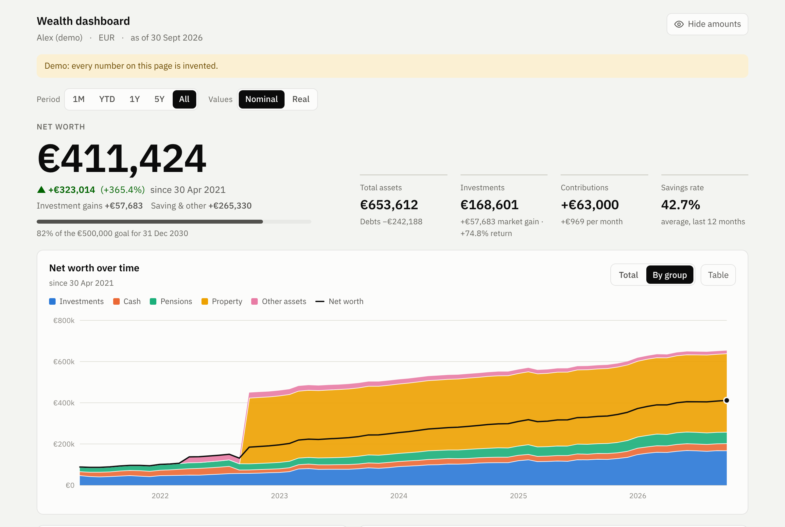
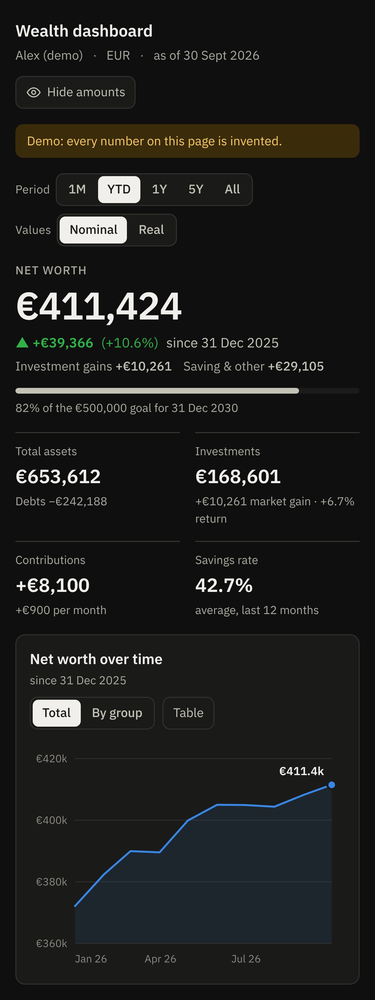

# Wealth dashboard for Claude

A Claude skill that interviews you about your money, builds a private dashboard of everything you own and owe,
and keeps it up to date with a short monthly check-in. No app, no server, no spreadsheet to maintain.



**[Open the live demo](https://dancingpea.github.io/wealth-dashboard/)** (every number in it is invented)

## What you get

- **Net worth over time**: 1M, YTD, 1Y, 5Y or All; total or stacked by group; nominal or adjusted for inflation
- **Where the change came from**: investment gains versus saving and everything else (debt repayment, property, pension)
- **Every account in one table**: cash, investments, pensions, property, other assets and debts, with an *estimated* tag on anything not refreshed this month
- **Holdings**: gain and return per position since purchase, prices refreshed for you
- **Allocation** by group, by account or by asset class
- **Monthly budget**: income versus spending, savings rate, spending by category compared with your own average
- **A goal** to track, a **Hide amounts** button for screenshots, light and dark mode, phone-friendly, in English, French, Dutch, German or Spanish



## How it works

1. **Install the skill once** (below).
2. **Say "Set up my wealth dashboard."** Claude asks plain questions for about 15 minutes. Rough numbers are fine,
   and you can answer with screenshots of your banking and broker apps or with exports.
3. **Claude builds the page** and publishes it privately in your Claude account, or saves it as a file on your computer.
4. **Once a month**, a scheduled task refreshes everything that can be refreshed without you (share and fund prices,
   currency rates, crypto balances, loan balances, your car's value) and then sends you a short list of what it still
   needs, usually two or three numbers. Anything you skip stays marked as estimated.

The dashboard page holds its own data, so there is no database and nothing to host. To change anything later, just ask:
"add my new savings account", "I paid off the car loan", "show it in French", "set a goal of 500k by 2032".

## Install

### In the Claude app (web, desktop, mobile)

1. Download **[wealth-dashboard.zip](https://github.com/dancingpea/wealth-dashboard/raw/main/dist/wealth-dashboard.zip)**.
2. In Claude, open **Settings > Capabilities** and make sure **Code execution and file creation** is on.
3. Open **Customize > Skills** and upload the zip.
4. Start a new chat and say: **Set up my wealth dashboard**.

### In Claude Code

```
/plugin marketplace add dancingpea/wealth-dashboard
/plugin install wealth-dashboard@wealth-dashboard
```

Then ask Claude to set up your wealth dashboard. It is saved as a file in a folder you choose
(by default `~/wealth-dashboard/`).

## Good to know

- **Plans.** Skills work on every Claude plan, including Free. Setup is a long conversation, so on the Free plan you may
  hit a usage limit halfway; you can pick it up again later.
- **Monthly check-in.** This uses scheduled tasks when your Claude app offers them. Without them, type
  "Update my wealth dashboard" once a month.
- **Bank connections.** Claude only uses connectors that you switch on yourself (some brokers, for example
  Interactive Brokers, have one). Most banks don't, and that's fine: a screenshot or an export does the job.
- **Your existing spreadsheet.** Send it during setup and Claude imports your history, so the chart starts years back.
- **Couples, several currencies, crypto in your own wallet, gold coins, a mortgage in several parts**: all handled
  during the interview.

## Privacy

- You never give passwords, PINs or account numbers, and the skill won't store them.
- Your figures live inside your dashboard page: a private page in your Claude account, or a file on your computer.
  Nothing is sent to this repository or to its author.
- Claude looks up public prices on the web. If you choose automatic crypto tracking, your public wallet address is
  sent to a public block explorer to read its balance.
- Before sharing a screenshot, press **Hide amounts**. Before sharing the page's link, remember it shows your finances.

## What's inside

```
plugin/skills/wealth-dashboard/
  SKILL.md                    instructions Claude follows (setup, monthly update, changes)
  references/interview.md     the guided interview, question by question
  references/data-sources.md  where each number comes from (connectors, prices, crypto, loans, inflation)
  references/data-format.md   the data schema
  references/scheduling.md    the monthly check-in task
  scripts/wealth.py           data tool: validates every change, computes holdings and loan balances, renders the page
  assets/dashboard.html       the dashboard template: one self-contained file, no libraries, hand-drawn SVG charts
  assets/demo-data.json       invented demo data
dist/wealth-dashboard.zip     the skill, ready to upload
docs/                         live demo and screenshots
tools/                        build scripts (python3 tools/build.py)
```

`wealth.py` runs with the Python standard library only. Try it locally:

```
python3 plugin/skills/wealth-dashboard/scripts/wealth.py new demo.html --from plugin/skills/wealth-dashboard/assets/demo-data.json
python3 plugin/skills/wealth-dashboard/scripts/wealth.py summary demo.html
```

## Disclaimer

This is a personal tracking tool. Values are estimates and nothing here is financial, tax or investment advice.

## License

MIT. Made by [@dancing_pea](https://x.com/dancing_pea). Issues and pull requests welcome.
