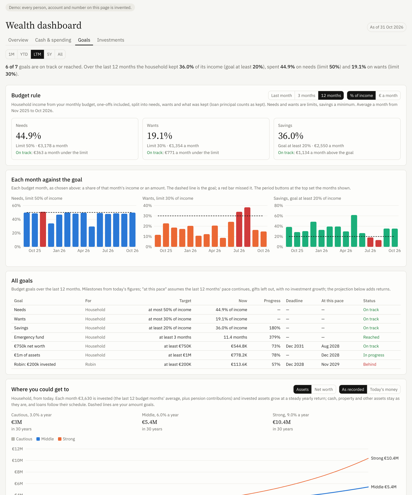

# Wealth dashboard for Claude

A Claude skill that interviews you about your money, builds a private dashboard of everything you and your household
own and owe, and keeps it up to date with a short monthly check-in. No app, no server, no spreadsheet to maintain.


**[Open the live demo](https://dancingpea.github.io/wealth-dashboard/)** (an invented household: every person and number is made up)

## What you get

**Overview**
- Net worth, assets and debt for the household and for each person, with joint accounts split the way you choose
- How it changed since 1 January, split into what you **saved**, what **markets** did, and **gifts**
- Wealth over time from one month to all history, as lines or stacked by category, with debt netted or shown apart
- Breakdown by category, and where your investments are by region
- **How you compare**: your percentile for net worth, income per person, household income, earnings and saving rate,
  against all households and your age group, in the countries you pick (EU countries, Norway, Switzerland, the US and more)
- Every line you own and owe, how it updates, and what is estimated

**Cash & spending**: cash and how many months of spending it covers, monthly income against spending, where the money goes.

**Goals**
- The 50/30/20 rule out of the box (needs at most half of income, wants at most 30%, keep at least 20%), checked over
  the last month, 3 months or 12 months, month by month
- Your own goals with deadlines: net worth, invested, assets, cash, debt or an emergency fund, with the date you reach
  each at your current pace
- **Where you could get to**: 30 years ahead in three return scenarios, in today's money if you like, with the month
  each goal is reached

**Investments**: every position with its gain since you bought it, by asset class and account, and a price chart per
position. With the Interactive Brokers connector, an optional **live** tab straight from your account.



## How it works

1. **Install the skill once** (below).
2. **Say "Set up my wealth dashboard."** Claude asks plain questions for about 15 minutes. Rough numbers are fine,
   and you can answer with screenshots of your banking and broker apps or with exports.
3. **Claude builds your dashboard** as a private artifact in your Claude account.
4. **Once a month**, a scheduled task refreshes what it can on its own (share and fund prices, exchange rates, crypto
   balances, loan balances, your car's value), then sends you a short list of what it still needs, usually two or
   three numbers. Anything you skip stays marked as estimated.
5. **To change anything, ask**: "make my savings goal 25%", "add a goal of 500k by 2032", "Robin and I split the joint
   account 60/40", "compare us with Spain too", "add my new savings account".


## Install

### In the Claude app (web, desktop, mobile)

1. Download **[wealth-dashboard.zip](https://github.com/dancingpea/wealth-dashboard/raw/main/dist/wealth-dashboard.zip)**.
2. In Claude, open **Settings > Capabilities** and make sure **Code execution and file creation** is on.
3. Open **Customize > Skills** and upload the zip.
4. Start a new chat and say: **Set up my wealth dashboard**.

### In Claude Code

```
/plugin marketplace add dancingpea/wealth-dashboard
/plugin install wealth-dashboard@wealth-dashboard
```

Then ask Claude to set up your wealth dashboard. Without artifacts, it is saved as a self-contained HTML page plus a
`wealth.json` file in a folder you choose (by default `~/wealth-dashboard/`).

### Updating from version 1

Ask Claude to "update my wealth dashboard to version 2": `wealth.py migrate` converts a version 1 page into the new
data file, then Claude builds the new dashboard from it.

## Good to know

- **Plans.** Skills work on every Claude plan. Setup is a long conversation, so on the Free plan you may hit a usage
  limit halfway; you can pick it up again later.
- **Monthly check-in.** Uses scheduled tasks where your Claude app offers them. Without them, type "Update my wealth
  dashboard" once a month.
- **Bank connections.** Claude only uses connectors you switch on yourself, and only to read. Most banks have none,
  and that's fine: a screenshot or an export does the job.
- **Your existing spreadsheet.** Send it during setup and Claude imports your history, so the chart starts years back.
- **Language.** Claude talks with you in your language; the dashboard's own labels are in English for now, while your
  account, category and goal names show as you write them.

## Privacy

- You never give passwords, PINs or account numbers, and the skill won't store them.
- Your figures live in your dashboard: a private artifact in your Claude account (or files on your computer). Nothing
  is sent to this repository or its author. Anyone you share the dashboard with sees everything on it.
- Claude looks up public prices on the web. If you choose automatic crypto tracking, your public wallet address is
  sent to a public block explorer to read its balance.
- The comparison tables ship with the skill, so your figures are placed in them on your screen; they are never sent
  anywhere.

## What's inside

```
plugin/skills/wealth-dashboard/
  SKILL.md                     instructions Claude follows (setup, monthly update, changes)
  references/interview.md      the guided interview, question by question
  references/publishing.md     building and updating the Dashboard artifact, step by step
  references/data-sources.md   where each number comes from (connectors, prices, crypto, loans, regions)
  references/data-format.md    the data file and the datasets the page reads
  references/scheduling.md     the monthly check-in task
  scripts/wealth.py            data tool: validates every change, works out loans and holdings, writes the datasets
  assets/page/                 the dashboard page (HTML, CSS and JavaScript on d3), the same for every user
  assets/standalone/           what lets the same page run as a plain file
  assets/reference/            survey percentiles by country and age (public statistics)
  assets/demo-state.json       the invented demo household
dist/wealth-dashboard.zip      the skill, ready to upload
docs/                          live demo and screenshots
tools/                         build scripts: demo data, comparison tables (python3 tools/peers.py, reference_data.py)
```

`wealth.py` needs only Python's standard library. Try it:

```
python3 plugin/skills/wealth-dashboard/scripts/wealth.py summary plugin/skills/wealth-dashboard/assets/demo-state.json
python3 plugin/skills/wealth-dashboard/scripts/wealth.py standalone plugin/skills/wealth-dashboard/assets/demo-state.json demo.html
```

## Comparison data

Eurostat (EU-SILC income distribution, Structure of Earnings Survey, household saving rate), the ECB Household Finance
and Consumption Survey, Statistics Netherlands (CBS), the US Federal Reserve Survey of Consumer Finances and the US
Bureau of Labor Statistics via FRED. Figures are brought to recent prices with each country's consumer price index.
Each table's source and year show on hover in the dashboard and in `assets/reference/peers_meta.json`.

## Disclaimer

This is a personal tracking tool. Values are estimates and nothing here is financial, tax or investment advice.

## License

MIT. Made by [@dancing_pea](https://x.com/dancing_pea). Issues and pull requests welcome.
